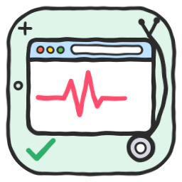

<p align="center">
  
</p>

<h1 align="center">Website studio — Claude Skill</h1>

<p align="center">
  <a href="LICENSE"></a>
  
  
</p>

<p align="center">
📚 Faz parte da <b><a href="https://github.com/mozuraa/claude-skills">biblioteca de skills de mozuraa</a></b> · Part of <b><a href="https://github.com/mozuraa/claude-skills">mozuraa's skills library</a></b>
</p>

<p align="center"><b>🇬🇧 English · <a href="README.pt.md">🇵🇹 Português</a></b></p>

---

A **complete website studio** for **Claude**, with three linked modes:

| Mode | What for | Example request |
|---|---|---|
| 💡 **Ideate** | Detailed ideas for a **new site** or to **improve your site** (more contacts, sales, Google visits) | "My site barely brings in customers, any ideas?" |
| 🛠️ **Create** | **Builds a complete site from scratch with you**, from the brief to launch, with a ready-made starter site | "I want a website for my restaurant" |
| 🩺 **Diagnose** | **Examines and fixes** everything that affects the site: 12 areas, 150+ checks, a health report with an opinion | "Is my site secure? It's slow on mobile" |

In every mode Claude **asks questions, shows evidence, gives its honest opinion and only goes ahead with your approval**. The idea approved in Ideate moves on to Create; Create ends with a Diagnose check-up; a diagnosis can lead to new ideas.

### 💡 Ideate

- Two or three **well-developed** ideas, each with: what it is, the goal, how it looks on the site, technology and cost, effort, first steps, risks and how to measure it.
- Before suggesting improvements, it **looks at your site** so it doesn't suggest what's already there.
- It uses an [inspiration catalog](references/idear/inspiracao.md) by goal and by type of site, and tells you frankly which ideas to avoid (carousels, chat widgets nobody answers, abandoned blogs...).

### 🛠️ Create

```
1. Brief ─► 2. Plan ─► ✋ ─► 3. Visual identity ─► 4. Home page ─► ✋ ─► 5. Rest of the site ─► 6. Verification ─► ✋ ─► 7. Launch
```

- **Brief** with the right questions for 11 types of site.
- **Plan** with the technology, hosting and costs, plus its opinion. ✋ You approve.
- **A visual identity of its own**, not a generic template.
- **Home page** first, with screenshots on mobile and desktop. ✋ You approve.
- **Rest of the site**: pages, 404, legal pages and SEO.
- **Verification**: Lighthouse ≥ 90, accessibility, privacy. ✋ You approve.
- **Launch**: domain, email, Search Console and a `COMO-EDITAR.md` editing guide.
- **Guides:** [`briefing`](references/criar/briefing.md) · [`stack`](references/criar/stack.md) (technology, hosting, forms, CMS, cookie-free analytics, costs) · [`design`](references/criar/design.md) · [`paginas`](references/criar/paginas.md) (content and EU/Portugal legal pages) · [`qualidade`](references/criar/qualidade.md) · [`lancamento`](references/criar/lancamento.md).
- **[Starter site](assets/starter/)** tested on mobile, desktop and dark mode. It has accessible HTML, CSS with design tokens, SEO and social sharing, security headers, zero trackers, a 404 page, a privacy policy and about 1 KB of JavaScript.

### 🩺 Diagnose

**Consultation → examination with evidence → health report (🔴🟠🟡🟢) → my opinion → you decide → verified treatment → discharge.**

The examination covers 12 areas: functionality · layout and alignment · images · performance (Core Web Vitals) · security (HTTPS, CSP, exposed secrets, XSS...) · privacy and GDPR · accessibility (WCAG 2.2 AA) · SEO · content · compatibility · domain, hosting and email · code quality.

Guides: [`checklist`](references/diagnostico/checklist.md) (150+ checks) and [`como-verificar`](references/diagnostico/como-verificar.md) (commands and tools for each check).

### Safety and ethics

It only examines your own sites, and security checks are always passive: it never attacks or exploits anything. It never copies other people's sites and never invents prices, testimonials or numbers. It also doesn't create accounts or make purchases for you: it tells you exactly what to do.

### Examples (in Portuguese)

- [Ideate: ideas for a bicycle repair shop](examples/idear.md)
- [Create: brief and plan for a pilates studio](examples/criar.md)
- [Diagnose: health report for a bakery](examples/diagnosticar.md)

### Installation

**Claude Code**

```bash
git clone https://github.com/mozuraa/claude-skill-website-studio.git ~/.claude/skills/website-studio
```

Or tell Claude in a new chat: *"install the skill from this link: https://github.com/mozuraa/claude-skill-website-studio"*.

**Or with the whole library, as a plugin:**

```
/plugin marketplace add mozuraa/claude-skills
/plugin install estudios@mozuraa-skills
```

**Claude app / claude.ai:** click **Code → Download ZIP** and upload the ZIP under **Settings → Capabilities → Skills**.

Start a new session so the skill loads. To update: `cd ~/.claude/skills/website-studio && git pull`.

### Structure

```
claude-skill-website-studio/
├── SKILL.md                     # the 3 modes and shared rules
├── references/
│   ├── idear/inspiracao.md      # ideas by goal and by type of site
│   ├── criar/                   # briefing, stack, design, paginas, qualidade, lancamento
│   └── diagnostico/             # checklist (12 areas) and como-verificar (commands)
├── assets/starter/              # starter site ready to adapt
├── examples/                    # idear.md, criar.md, diagnosticar.md
├── icon.svg · README.md · README.pt.md · CHANGELOG.md · LICENSE
```

The skill's instructions are written in Portuguese, but Claude replies in whatever language you write in.

### History

Version 2.0 merges two earlier skills, **website-builder** and **website-doctor** (their git histories are preserved in this repository), and adds the Ideate mode.

### License

[MIT](LICENSE). The legal page templates are starting points and are not a substitute for legal advice.
