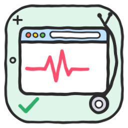

<p align="center">
  
</p>

<h1 align="center">Website studio — Claude Skill</h1>

<p align="center">
  <a href="LICENSE"></a>
  
  
</p>

<p align="center">
📚 Faz parte da <b><a href="https://github.com/mozuraa/claude-skills">biblioteca de skills de mozuraa</a></b> · Part of <b><a href="https://github.com/mozuraa/claude-skills">mozuraa's skills library</a></b>
</p>

<p align="center"><b><a href="README.md">🇬🇧 English</a> · 🇵🇹 Português</b></p>

---


Um **estúdio completo de websites** para o **Claude**, com três modos que se encadeiam:

| Modo | Para quê | Exemplo de pedido |
|---|---|---|
| 💡 **Idear** | Ideias detalhadas para um **site novo** ou para **melhorar o teu site** (mais contactos, vendas, visitas do Google) | "O meu site quase não traz clientes, ideias?" |
| 🛠️ **Criar** | **Constrói um site completo de raiz contigo**, do briefing à publicação, com um site-base pronto | "Quero um site para o meu restaurante" |
| 🩺 **Diagnosticar** | **Examina e corrige** tudo o que afeta o site: 12 áreas, 150+ verificações, relatório de saúde com opinião | "O meu site é seguro? Está lento no telemóvel" |

Em todos os modos o Claude **faz perguntas, mostra provas, dá a sua opinião honesta e só avança com a tua autorização**. A ideia aprovada no Idear passa ao Criar; o Criar termina com um exame do Diagnosticar; um diagnóstico pode levar a novas ideias.

### 💡 Idear

- Duas a três ideias **bem desenvolvidas**, cada uma com: o que é, o objetivo, como fica no site, tecnologia e custo, esforço, primeiros passos, riscos e como medir.
- Antes de propor melhorias, **vê o teu site** para não sugerir o que já existe.
- Usa um [catálogo de inspiração](references/idear/inspiracao.md) por objetivo e por tipo de site, e diz-te francamente que ideias evitar (carrosséis, chats sem ninguém, blogs abandonados...).

### 🛠️ Criar

```
1. Briefing ─► 2. Plano ─► ✋ ─► 3. Identidade visual ─► 4. Página inicial ─► ✋ ─► 5. Resto do site ─► 6. Verificação ─► ✋ ─► 7. Lançamento
```

- **Briefing** com as perguntas certas para 11 tipos de site.
- **Plano** com a tecnologia, o alojamento e os custos, mais a sua opinião. ✋ Aprovas.
- **Identidade visual** própria, não um modelo genérico.
- **Página inicial** primeiro, com capturas em telemóvel e computador. ✋ Aprovas.
- **Resto do site**: páginas, 404, páginas legais e SEO.
- **Verificação**: Lighthouse ≥ 90, acessibilidade, privacidade. ✋ Aprovas.
- **Lançamento**: domínio, email, Search Console e um guia `COMO-EDITAR.md`.
- **Guias:** [`briefing`](references/criar/briefing.md) · [`stack`](references/criar/stack.md) (tecnologia, alojamento, formulários, CMS, estatísticas sem cookies, custos) · [`design`](references/criar/design.md) · [`paginas`](references/criar/paginas.md) (conteúdo e páginas legais UE/Portugal) · [`qualidade`](references/criar/qualidade.md) · [`lancamento`](references/criar/lancamento.md).
- **[Site-base](assets/starter/)** testado em telemóvel, computador e modo escuro. Tem HTML acessível, CSS com *design tokens*, SEO e partilha, cabeçalhos de segurança, zero rastreadores, 404, política de privacidade e cerca de 1 KB de JavaScript.

### 🩺 Diagnosticar

**Consulta → exame com provas → relatório de saúde (🔴🟠🟡🟢) → a minha opinião → decides → tratamento verificado → alta.**

O exame cobre 12 áreas: funcionamento · layout e alinhamentos · imagens · desempenho (Core Web Vitals) · segurança (HTTPS, CSP, segredos expostos, XSS...) · privacidade e RGPD · acessibilidade (WCAG 2.2 AA) · SEO · conteúdo · compatibilidade · domínio, alojamento e email · qualidade do código.

Guias: [`checklist`](references/diagnostico/checklist.md) (150+ verificações) e [`como-verificar`](references/diagnostico/como-verificar.md) (comandos e ferramentas para cada uma).

### Segurança e ética

Só examina sites teus, e as verificações de segurança são sempre passivas: nunca ataca nem explora falhas. Nunca copia sites alheios e nunca inventa preços, testemunhos ou números. Também não cria contas nem faz compras por ti: diz-te exatamente o que fazer.

### Exemplos

- [Idear: ideias para uma oficina de bicicletas](examples/idear.md)
- [Criar: briefing e plano de um estúdio de pilates](examples/criar.md)
- [Diagnosticar: relatório de saúde de uma padaria](examples/diagnosticar.md)

### Instalação

**Claude Code**

```bash
git clone https://github.com/mozuraa/claude-skill-website-studio.git ~/.claude/skills/website-studio
```

**Ou com toda a biblioteca, como plugin:**

```
/plugin marketplace add mozuraa/claude-skills
/plugin install estudios@mozuraa-skills
```

**App Claude / claude.ai:** carrega em **Code → Download ZIP** e carrega o ZIP nas **Definições**, na secção **Skills** (em *Capacidades*).

Abre uma sessão nova para a skill ser carregada. Para atualizar: `cd ~/.claude/skills/website-studio && git pull`.

### Estrutura

```
claude-skill-website-studio/
├── SKILL.md                     # os 3 modos e as regras comuns
├── references/
│   ├── idear/inspiracao.md      # ideias por objetivo e por tipo de site
│   ├── criar/                   # briefing, stack, design, paginas, qualidade, lancamento
│   └── diagnostico/             # checklist (12 áreas) e como-verificar (comandos)
├── assets/starter/              # site-base pronto a adaptar
├── examples/                    # idear.md, criar.md, diagnosticar.md
├── icon.svg · README.md · README.pt.md · CHANGELOG.md · LICENSE
```

### História

A versão 2.0 junta duas skills anteriores, **website-builder** e **website-doctor**, cujos históricos de git estão preservados neste repositório, e acrescenta o modo Idear.

### Licença

[MIT](LICENSE). Os modelos de páginas legais são pontos de partida e não substituem aconselhamento jurídico.
